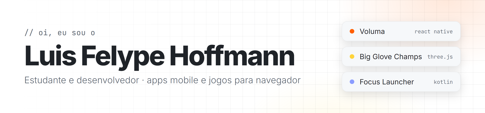
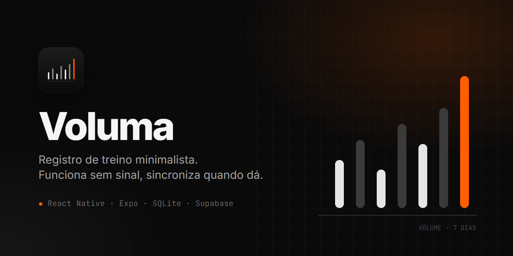
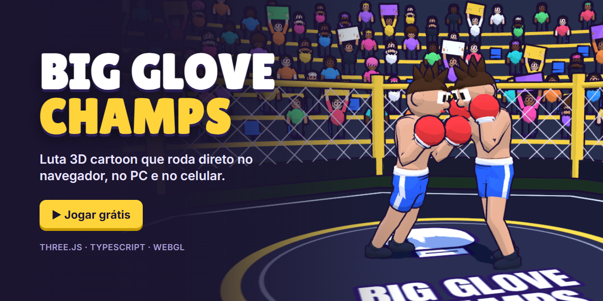
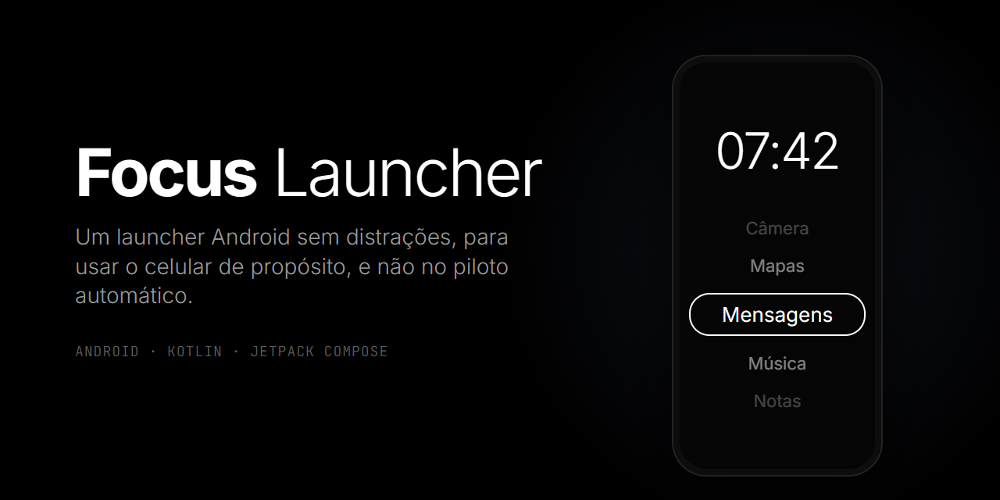

<picture>
  <source media="(prefers-color-scheme: dark)" srcset="assets/banner-dark.png">
  
</picture>

Estudante e desenvolvedor em Santo Ângelo, RS. Gosto de apps que funcionam bem no mundo real (sem sinal, sem distração) e de jogos que dá para abrir direto no navegador.

### Projetos

<table>
  <tr>
    <td width="50%" valign="top">
      
      
<b><a href="https://github.com/luisfelypehoffmanndev/Voluma">Voluma</a></b> 
      App de treino local-first: registra séries sem sinal e sincroniza via Supabase. Inclui painel web para academias.

    </td>
    <td width="50%" valign="top">
      
      
<b><a href="https://github.com/luisfelypehoffmanndev/big-glove-champs">Big Glove Champs</a></b> · <a href="https://luisfelypehoffmanndev.github.io/big-glove-champs/">jogar ▶</a> 
      Jogo de luta 3D cartoon em Three.js: carreira com 4 ligas, editor de lutador, teclado, toque e controle.

    </td>
  </tr>
  <tr>
    <td width="50%" valign="top">
      
      
<b><a href="https://github.com/luisfelypehoffmanndev/focus-launcher-beta">Focus Launcher</a></b> 
      Launcher Android minimalista para usar o celular de propósito. APK de teste disponível.

    </td>
    <td width="50%" valign="top">
      <h4>Com o que eu trabalho</h4>
      
    </td>
  </tr>
</table>
